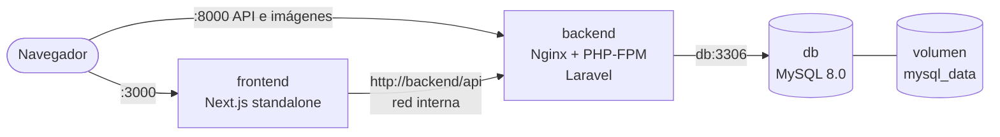

# MercaditoSV · Ecosistema contenerizado (Next.js + Laravel + MySQL)

Actividad evaluada: **Ingeniería de Imágenes Eficientes: Refactorización Multi-stage y Optimización de Capas en Docker**.

Tienda en línea de abarrotes de El Salvador, preparada para producción con tres servicios orquestados por un único `docker-compose.yml`:

| Servicio | Tecnología | Carpeta | Puerto |
|---|---|---|---|
| `frontend` | Next.js 16 (App Router), Node 20 Alpine | [`tienda/`](./tienda) | 3000 |
| `backend` | Laravel 12, PHP 8.4-FPM Alpine + Nginx | [`ejercicio-pedidos/`](./ejercicio-pedidos) | 8000 → 80 |
| `db` | MySQL 8.0 (imagen oficial) | — | 3306 (solo red interna) |

Versión en vivo (despliegue previo, fuera de Docker): frontend en Vercel `<URL>` · API en Render `<URL>`.

## Arquitectura de contenedores



- **Dos redes aisladas**: `data` (db ↔ backend) y `web` (backend ↔ frontend). El frontend **no puede** alcanzar la base de datos.
- **MySQL no publica puertos** al host: el 3306 solo existe dentro de Docker.
- Los datos persisten en el volumen `mysql_data` (`/var/lib/mysql`).
- `depends_on` con `condition: service_healthy`: db → backend → frontend arrancan en orden, cada uno cuando el anterior está sano.

## Cómo ejecutarlo

Requisitos: Docker Desktop (o Docker Engine + Compose v2).

```bash
# 1. Variables de entorno
cp .env.example .env            # en PowerShell: copy .env.example .env

# 2. Genera APP_KEY (no necesitas PHP instalado) y pégala en .env
docker run --rm php:8.4-cli-alpine php -r "echo 'base64:'.base64_encode(random_bytes(32)).PHP_EOL;"

# 3. Edita .env: contraseñas de MySQL, APP_KEY y claves de Stripe (modo de prueba)

# 4. Construye y levanta todo con un solo comando
docker compose up -d --build

# 5. Solo la PRIMERA vez: carga categorías y productos de ejemplo
docker compose exec backend su-exec www-data php artisan db:seed --force
```

> No repitas el paso 5: `ProductSeeder` usa `Product::create` y duplicaría los productos.

| Qué | URL |
|---|---|
| Tienda | http://localhost:3000 |
| API (estado) | http://localhost:8000 |
| Swagger | http://localhost:8000/api/documentation |

```bash
docker compose ps                  # estado y health de los tres servicios
docker compose logs -f backend     # logs (Nginx + PHP-FPM + Laravel en stdout/stderr)
docker compose down                # apaga (conserva los datos)
docker compose down -v             # apaga y BORRA el volumen de MySQL
```

> Las variables `NEXT_PUBLIC_*` se incrustan en el JavaScript del navegador **al construir**. Si cambias esas URLs en `.env`, ejecuta `docker compose up -d --build` otra vez.

## Decisiones técnicas por Dockerfile

### Frontend: `tienda/Dockerfile` (4 etapas)

| Etapa | Qué hace | Por qué |
|---|---|---|
| `base` | Node 20 Alpine + pnpm vía `corepack` | Usa exactamente la versión de pnpm del campo `packageManager`, sin instalar nada a mano |
| `deps` | Copia solo `package.json`, `pnpm-lock.yaml`, `pnpm-workspace.yaml` e instala | **Caché de capas**: mientras no cambie el lockfile, Docker no reinstala. Se suma un caché persistente del store de pnpm (`--mount=type=cache`) |
| `builder` | Copia el código y corre `pnpm build` | Las herramientas de compilación (TypeScript, ESLint, Tailwind…) nunca llegan a la imagen final |
| `runner` | Copia solo `public/`, `.next/standalone` y `.next/static` | Imagen mínima; `output: "standalone"` empaqueta únicamente las dependencias que el servidor realmente usa |

- **Seguridad**: usuario sin privilegios `nextjs` (uid 1001), `NODE_ENV=production`, sin telemetría, `.dockerignore` que deja fuera `.env`, `.git` y `node_modules`.
- **`node server.js` en lugar de `next start`**: es el servidor equivalente que genera el modo standalone (mismo comportamiento, menos archivos).
- **Variables**: `NEXT_PUBLIC_*` entran como `ARG` de build; `API_BASE_URL` es variable de runtime y apunta a `http://backend/api` por la red interna.

### Backend: `ejercicio-pedidos/Dockerfile` (2 etapas)

| Etapa | Qué hace | Por qué |
|---|---|---|
| `vendor` (`composer:2`) | `composer install --no-dev` copiando primero solo `composer.json` + `composer.lock`, y luego `dump-autoload --classmap-authoritative` | Caché por lockfile; Composer, git y los paquetes de desarrollo no llegan a producción; autoload optimizado |
| `runtime` (`php:8.4-fpm-alpine`) | Instala Nginx + supervisord, compila `pdo_mysql` y `opcache`, copia **solo `vendor/`** de la etapa anterior y luego el código | Imagen pequeña y sin herramientas de build |

- **PHP 8.4 y no 8.2**: el `composer.json` del proyecto exige `"php": "^8.4"`. El enunciado pide PHP 8.2+, así que 8.4 lo cumple.
- **Extensiones**: solo `pdo_mysql` y `opcache` se compilan; `mbstring`, `openssl`, `tokenizer`, `xml`, `ctype` y `json` ya vienen en la imagen oficial. El propio `Dockerfile` ejecuta `php -m | grep …` y **falla el build** si falta alguna.
- **Nginx + PHP-FPM en un contenedor** (con `supervisord`): Nginx sirve los estáticos (fotos de `public/productos`) y pasa los `.php` a FPM por `127.0.0.1:9000`. FPM solo escucha en loopback, no en la red de Docker.
- **`entrypoint.sh`**: con las variables reales del contenedor ejecuta `package:discover`, `config:cache`, `view:cache` y las migraciones (con reintentos mientras MySQL arranca). No usa `route:cache` porque el proyecto tiene rutas con *Closure*. Todo `artisan` corre como `www-data`, así los logs no quedan como `root`.
- **`.dockerignore`**: excluye `.env`, `vendor`, `node_modules`, las bases `*.sqlite`, los logs y `bootstrap/cache/*.php` (cachés generadas en Windows con paquetes de desarrollo que romperían el arranque).
- **Sin etapa de Node**: la API solo responde JSON; Vite/Tailwind del esqueleto de Laravel no se usan, así que no se compilan. Por eso `routes/web.php` responde un JSON en `/` en vez de la vista `welcome` (que requiere `@vite`).
- **Configuración de producción**: `php.ini-production`, `expose_php=Off`, OPcache con `validate_timestamps=0` (el código es inmutable en la imagen), `server_tokens off` y cabeceras básicas de seguridad en Nginx.
- **Logs a stdout/stderr** (`LOG_CHANNEL=stderr`) para verlos con `docker compose logs`.

### Base de datos: `mysql:8.0`

- Imagen oficial, **sin Dockerfile propio** (no hay nada que optimizar: solo configuración).
- Credenciales por variables de entorno (`MYSQL_ROOT_PASSWORD`, `MYSQL_DATABASE`, `MYSQL_USER`, `MYSQL_PASSWORD`), obligatorias: el compose falla con un mensaje claro si falta alguna.
- Volumen nombrado `mysql_data` en `/var/lib/mysql`.
- `db/init/01-charset.sql` montado en `/docker-entrypoint-initdb.d/` (solo lectura): fija `utf8mb4` en la base. Las tablas las crean las migraciones de Laravel.
- `healthcheck` con `mysqladmin ping`, del que depende el backend.

## Ejecución en GitHub Codespaces

Las pruebas se hicieron en un Codespace. Allí el navegador no entra por `localhost`, así que en `.env` las tres URLs públicas usan el dominio reenviado del puerto 8000:

```bash
BASE="https://${CODESPACE_NAME}-8000.${GITHUB_CODESPACES_PORT_FORWARDING_DOMAIN}"
sed -i "s|^APP_URL=.*|APP_URL=$BASE|; s|^NEXT_PUBLIC_API_URL=.*|NEXT_PUBLIC_API_URL=$BASE/api|; s|^NEXT_PUBLIC_IMAGE_URL=.*|NEXT_PUBLIC_IMAGE_URL=$BASE|" .env
gh codespace ports visibility 8000:public -c $CODESPACE_NAME   # el navegador necesita el puerto 8000 público
```

Cada vez que el Codespace se apaga y se vuelve a abrir, GitHub restablece la visibilidad de los puertos: hay que repetir el último comando para que carguen las imágenes.

## Medición: antes vs. después

`Dockerfile.baseline` (en cada servicio) es la versión ingenua de una sola etapa; sirve para medir la mejora.

```bash
# Después (optimizado) — lo construye docker compose
docker compose build

# Antes (línea base)
docker build -f ejercicio-pedidos/Dockerfile.baseline -t mercaditosv-backend:baseline ./ejercicio-pedidos
docker build -f tienda/Dockerfile.baseline -t mercaditosv-frontend:baseline \
  --build-arg NEXT_PUBLIC_API_URL=http://localhost:8000/api ./tienda

docker images | grep mercaditosv           # tamaños
docker history mercaditosv-frontend:latest # capas
```

| Imagen | Baseline | Optimizada | Reducción |
|---|---|---|---|
| frontend (`tienda`) | 2.67 GB | 251 MB | −90.6 % |
| backend (`ejercicio-pedidos`) | 954 MB | 285 MB | −70.1 % |

Tamaños medidos con `docker images` (tamaño descomprimido en disco) en GitHub Codespaces. Baseline = `Dockerfile.baseline` de una sola etapa; optimizada = `Dockerfile` multi-stage.

**Caché de capas**: cambia un solo archivo de código y vuelve a ejecutar `docker compose build`; las capas de dependencias aparecen como `CACHED`.

### Verificaciones útiles

```bash
docker compose exec backend php -m                 # extensiones cargadas
docker compose exec backend ls vendor/bin          # no debe haber phpunit (se instaló con --no-dev)
docker compose exec frontend whoami                # nextjs (no root)
docker compose port db 3306                        # imprime ":0": el puerto NO está publicado en el host
```

### Resultados de las verificaciones

- `frontend`: `whoami` → `nextjs` (no corre como root).
- `db`: `docker compose port db 3306` → `:0` (sin puerto publicado). `docker compose ps` lo muestra solo como `3306/tcp, 33060/tcp`.
- `backend`: `php -m` lista `pdo_mysql`, `mbstring`, `openssl`, `tokenizer`, `xml`, `ctype` y `json`.
- Los tres servicios llegan a `healthy` con `docker compose up -d --build`; la primera construcción en frío tardó unos 4–5 minutos y las siguientes unos 40 s gracias al caché de capas.

## Cambios hechos al código original

Para poder contenerizarlo sin cambiar el comportamiento:

1. `tienda/next.config.ts`: se añadió `output: "standalone"` y `experimental.serverActions.allowedOrigins` (`localhost:3000` y `*.app.github.dev`). Lo segundo es necesario porque el proxy de GitHub Codespaces reescribe el encabezado `Origin` y Next.js bloqueaba las Server Actions (login y registro) con "Invalid Server Actions request".
2. `tienda/src/app/actions/{auth,orders,payments}.ts` y `tienda/src/app/api/search/route.ts`: el código que corre **en el servidor** ahora prefiere `API_BASE_URL` (`http://backend/api`, red interna) y cae a `NEXT_PUBLIC_API_URL` si no existe. Sin esto, dentro de Docker el servidor intentaría llamar a `localhost:8000` (su propio contenedor).
3. `ejercicio-pedidos/routes/web.php`: la ruta `/` devuelve JSON en lugar de la vista `welcome`.
4. `ejercicio-pedidos/app/Models/User.php`: `#[Fillable]` y `#[Hidden]` (atributos) pasaron a las propiedades `$fillable` y `$hidden`. Con el Laravel 12 instalado los atributos no se aplicaban y el registro fallaba con `MassAssignmentException` (el seeder no lo detectaba porque `db:seed` corre sin protección de asignación masiva).
5. Se eliminaron archivos que no deben vivir en un repo público: bases `*.sqlite`, `storage/logs/laravel.log`, cachés de `bootstrap/cache`, `Procfile`/`railway.json` (despliegue anterior) y el `dockerfile` original de una sola etapa (queda como `Dockerfile.baseline`).

## Estructura del repositorio

```
.
├── docker-compose.yml
├── .env.example
├── db/init/01-charset.sql
├── tienda/                      # Frontend Next.js
│   ├── Dockerfile
│   ├── Dockerfile.baseline
│   └── .dockerignore
└── ejercicio-pedidos/           # API Laravel
    ├── Dockerfile
    ├── Dockerfile.baseline
    ├── .dockerignore
    └── docker/                  # nginx.conf, supervisord.conf, php-fpm.conf, php.ini, entrypoint.sh
```

## Notas

- Las claves de Stripe deben ser **de prueba** (`pk_test_…` / `sk_test_…`). El `.env` real nunca se sube al repositorio.
- El frontend construye y corre con `node:20-alpine`, la imagen que recomienda el enunciado.
- El usuario administrador que crea el seeder (`juan@test.com`) no tiene cliente asociado y no puede pagar; para comprar hay que registrarse desde `/registro`.
